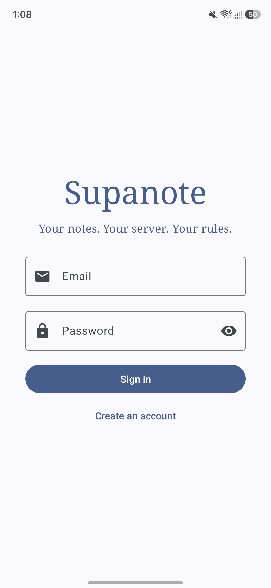
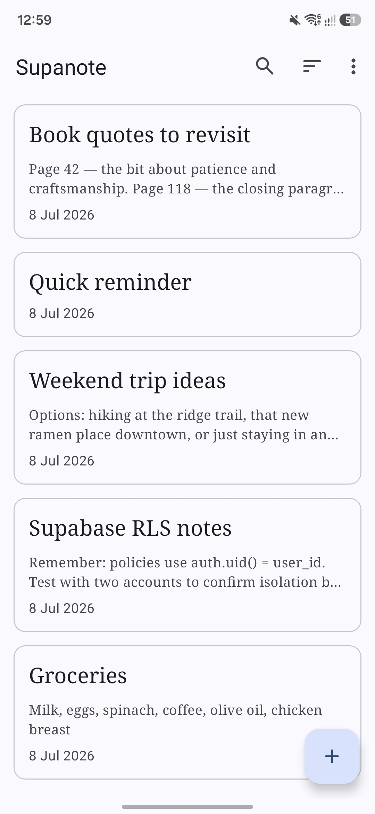
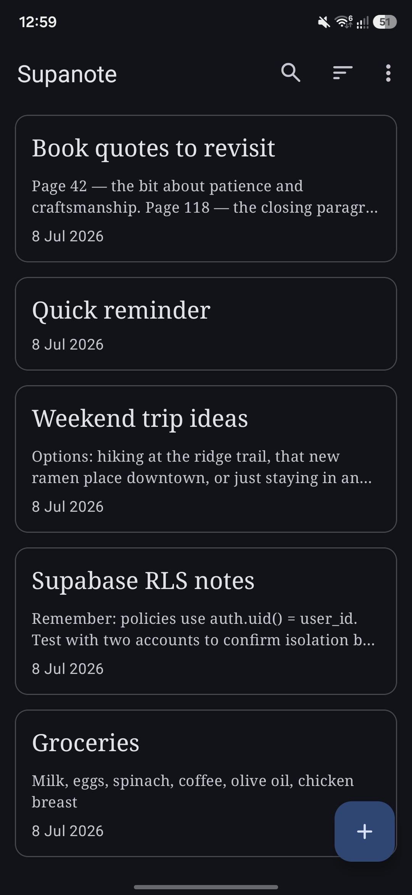
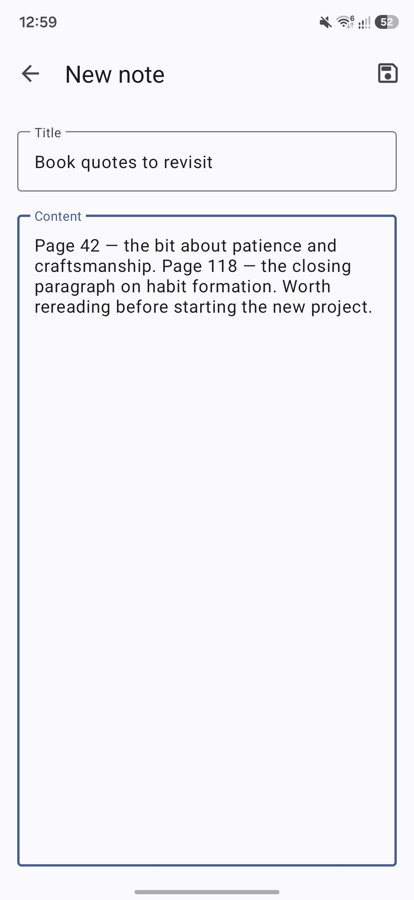
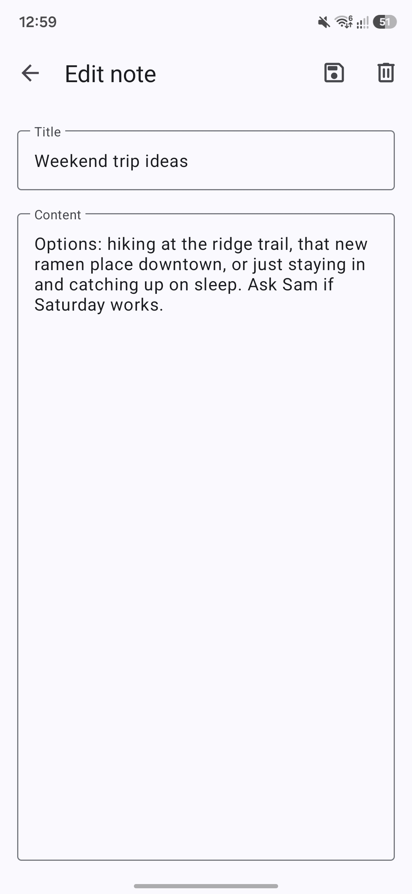
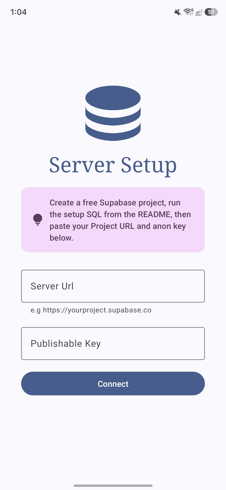

<div align="center">


# Supanote

**Your notes. Your server. Your rules.**

Supanote is a simple, open-source notes app that connects to your own Supabase backend instead of a company's servers. Whether you're using a free Supabase Cloud project or a self-hosted instance, your notes live where you decide.


</div>

## Features

* **Bring your own backend:** Connect to any Supabase project, Cloud or self-hosted, with your project URL and publishable key. Switch servers anytime from Settings.
* **Private per account:** Each account only sees its own notes, enforced by Row Level Security in your database.
* **Search and sort:** Filter by title or content, and sort by newest, oldest, or title.
* **Pin and trash:** Pin notes to keep them at the top. Deleted notes go to the trash first, where you can restore them or delete them for good.
* **Backup:** Export your notes to a JSON file and import them back.
* **Themes and privacy:** Light, dark, and dynamic colors, plus an optional screen privacy mode that blocks screenshots.

## Screenshots

<div align="center">
  
  
  
  
  
  
</div>

## Getting Started

You need Android 10 (API 29) or later, and a Supabase project that is reachable over **HTTPS**: either a free [Supabase Cloud](https://supabase.com) project or your own self-hosted instance.

1. Create a project at [supabase.com](https://supabase.com) (or run your own).
2. In the **SQL Editor**, run [`schema.sql`](schema.sql) to create the `notes` table, its Row Level Security policies, and the edit-time trigger. The script is safe to run again, so re-run it after updating Supanote to pick up database changes.
3. Under **Authentication → Sign In / Providers**, enable **Email**. For the easiest setup, turn off **Confirm email**; otherwise new users must confirm by email first, which needs working email delivery.
4. Copy your **Project URL** and **publishable key** from the project's **Connect** dialog (or **Settings → API Keys**). Legacy `anon` keys still work but are being deprecated by Supabase, so prefer the publishable key (`sb_publishable_...`).
5. Open Supanote, enter the URL and key on the setup screen, and create an account.

**Only use the publishable (or legacy anon) key.** Never paste a secret or `service_role` key into the app: it bypasses Row Level Security.

To use another server later, go to **Settings → Change server**.

## Good to know

* No analytics or telemetry. The app only talks to your server, and crash reports are only shared if you choose to send them.
* Notes are **not end-to-end encrypted**: whoever runs the server can read them. Row Level Security only keeps other users out.
* Importing a backup always adds new notes, so importing the same file twice creates duplicates, and original creation dates are not kept.
* Not included: offline mode, folders, tags, and archive.

## Verifying a download

<details>
<summary>Check the APK signature and the PGP signature</summary>

Release APKs on GitHub are signed with my key. Verify one with [apksigner](https://developer.android.com/studio/command-line/apksigner.html#options-verify):

```
apksigner verify --print-certs --verbose supanote.apk
```

It should report `Verifies`, with the certificate `CN=Mowtiie` and this SHA-256 digest. Only install APKs signed with this key:

```
8b6751f3c33185635f989530b6c073a1397b3d412befae6906a2eb5845d2de63
```

Each release also has a detached PGP signature (`.asc`), which confirms that I published that exact file. Import my key and check that the fingerprint matches before trusting it:

```
curl -O https://mowtiie.cc/PGP_PUBLIC_KEY.asc
gpg --import PGP_PUBLIC_KEY.asc
```

```
9EA2 8F46 7802 5092 7643 1B69 42B5 FA42 AA63 90E1
```

Then verify the download:

```
gpg --verify supanote-vX.X.apk.asc supanote-vX.X.apk
```

</details>

## Building from Source

Requires Android Studio (or the Android SDK) and a JDK.

```
./gradlew assembleDebug               # build
./gradlew installDebug                # install on a connected device
./gradlew testDebugUnitTest           # unit tests
./gradlew connectedDebugAndroidTest   # Keystore and backup tests, needs a device or emulator
```

`local.properties` can optionally hold `SUPABASE_URL` and `SUPABASE_KEY`. They pre-fill the setup screen in **debug builds only**; release builds always ship with these values empty.

Release builds are signed with a git-ignored `keystore.properties` in the repo root. Without it, `assembleRelease` produces an unsigned APK.

```
keyAlias=...
keyPassword=...
storeFile=/path/to/keystore.jks
storePassword=...
```

<details>
<summary>Releasing (maintainers)</summary>

1. Bump `versionCode` and `versionName` in `app/build.gradle.kts`.
2. Build the signed release with `./gradlew assembleRelease`. The APK is `app/build/outputs/apk/release/app-release.apk`.
3. Verify it as described in [Verifying a download](#verifying-a-download) and check that the certificate matches.
4. Optionally create a detached PGP signature: `gpg --armor --detach-sign supanote-vX.X.apk`.
5. Publish the APK, the `.asc` file, and `mapping-<version>.txt` on GitHub.

The mapping file is `app/build/outputs/mapping/release/mapping.txt`, renamed with the version. Release builds are minified with R8, so it is needed to read crash reports: match it to the version under "App Info" in the report and run `retrace` from the Android SDK command-line tools.

</details>

## Contributing

Issues and pull requests are welcome. For bugs, please include your Android version and the steps to reproduce. Before opening a pull request, make sure `./gradlew assembleDebug lintDebug testDebugUnitTest` passes.

## License

This project is licensed under the GNU General Public License v3.0. See the
[LICENSE](LICENSE) file for details.
